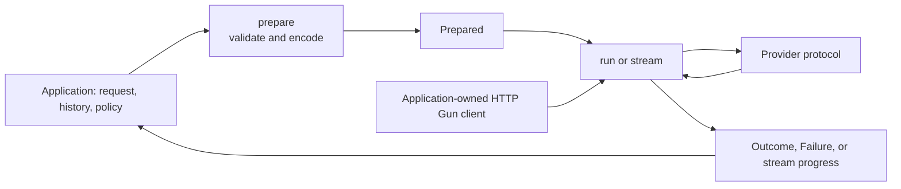

# LLM Wire

Typed, bounded LLM interactions for Gleam on Erlang/OTP. Use it when an application needs provider calls and typed results while keeping conversation history, tool effects, and retry policy under application control. This checkout is an unreleased `0.1.0` candidate and requires Gleam 1.18 or newer.

## What it provides

- Built-in generation adapters for OpenAI Responses, Anthropic Messages, and Google GenerateContent, plus a custom adapter interface.
- Reusable generation settings for output-token limits, temperature, top-p, stop sequences, and provider-specific cache references.
- Codec-backed structured answers decoded into Gleam values, with unsupported provider schema profiles rejected during preparation.
- Typed tool declarations and admitted tool calls. The caller decides whether to authorize and execute each call.
- Semantic streaming progress or a collected outcome, including text, tool arguments, refusal, reasoning, and usage updates.
- Finite request, response, queue, text, and tool-argument bounds, with whole-call, first-progress, and idle-gap timeouts.
- Normalized outcomes and failures with send evidence, plus retry advice that can include the provider's `Retry-After` delay.
- Typed classification questions with a built-in TypeSafe wire, custom pure wires, and durable evidence receipts.
- Bounded inline Google audio transcription that returns completed text.
- Offline scripted-provider testing and correlated Sinal lifecycle observations.

## When to use it

Use LLM Wire for typed extraction or generation in a backend or interactive application; for an agent that needs an explicit tool loop; or for typed classification and short inline-audio transcription. Its core lifecycle is `Request -> prepare -> Prepared -> run/stream -> Outcome or Failure`:



The application owns the shared HTTP Gun client and can supervise it under its OTP supervisor. A generation stream has a per-call owner process that coordinates its HTTP work; the caller's process owns the stream lifetime. Classification and transcription use separate buffered request lifecycles.

LLM Wire is a wire and execution library, not an agent framework. The caller owns the conversation loop, history and storage, authorization, tool execution, retries, round budgets, and durable recovery. The built-in classification wire is TypeSafe; other protocols need a custom wire. Transcription handles one bounded inline audio request, not real-time audio or remote file management.

## Install

Add LLM Wire and HTTP Gun to an Erlang-targeted Gleam application. Declare HTTP Gun directly when passing its client to LLM Wire. These Git `main` declarations match the package manifest; commit the generated `manifest.toml` to record the revisions resolved for your application.

```toml
[dependencies]
llm_wire = { git = "https://github.com/gleam-dream/llm_wire.git", ref = "main" }
http_gun = { git = "https://github.com/gleam-dream/http_gun.git", ref = "main" }
```

## Make a call

The application starts and owns its HTTP Gun client. Pass that client and a
provider configuration to this function. Import `http_gun`, `llm_wire`,
`llm_wire/error` and `llm_wire/openai`; the [complete consumer](examples/consumer/src/llm_wire_consumer.gleam)
supplies the imports and exercises the same function with scripted responses.
For a real provider, supply your own API key and select an available model.

<!-- prettier-ignore-start -->

<!-- snips: examples/consumer/src/llm_wire_consumer.gleam#common-call -->
```gleam
/// OpenAI with the default limits and timeouts.
pub fn openai_config(api_key: String) -> llm_wire.Config {
  openai.new(api_key) |> openai.config
}

pub fn question(text: String) -> llm_wire.Request(String) {
  llm_wire.request("gpt-5", [llm_wire.user(text)])
}

/// Prepare, run, and read the answer or a one-line failure.
pub fn ask(
  client: http_gun.Client,
  config: llm_wire.Config,
  text: String,
) -> Result(String, String) {
  case llm_wire.prepare(config, question(text)) {
    Error(problem) -> Error(error.describe_prepare_error(problem))
    Ok(prepared) ->
      case llm_wire.run(client, prepared) {
        Ok(llm_wire.Answer(text:, ..)) -> Ok(text)
        Ok(_) -> Error("no final answer")
        Error(failure) -> Error(llm_wire.describe_failure(failure))
      }
  }
}

```

<!-- prettier-ignore-end -->

`prepare` validates and encodes without I/O. `run` performs one call and returns a typed outcome or failure. For generation, the default whole-call timeout is 600 seconds, first semantic progress is 180 seconds, and the idle gap is 60 seconds. See [all generation bounds](src/llm_wire/limit.gleam) and [generation settings](src/llm_wire/generation.gleam).

## Operational notes

- `llm_wire.advise` reports whether another attempt may help; it never schedules a retry. A `MaybeSent` failure may already have cost tokens. Cap a provider delay against the caller's remaining budget before sleeping.
- Closing a stream ends local work. It does not prove that the provider rolled back or stopped processing the request.
- Request JSON and prompts can contain sensitive data; transcription request JSON contains the encoded audio. Do not log them by default.
- Structured-output codecs must fit the selected provider's admitted schema profile. Preparation reports unsupported schemas before execution.
- Keep transport trust and destination policy on the application-owned HTTP Gun client; use HTTPS for remote endpoints.

## Examples and references

The [public consumer examples](examples/consumer/README.md) are compiled offline programs covering structured output, tool rounds, streaming, retry advice, classification, transcription, client ownership, testing, and observation. The [design overview](docs/design/design-layer.pdf) describes behavior and ownership. [Benchmark notes](docs/BENCHMARKS.md) retain a dated local HTTP measurement and its limits; they make no provider-latency claim.

For local validation, see [AGENTS.md](AGENTS.md). Provider recording is opt-in and contacts external services.
